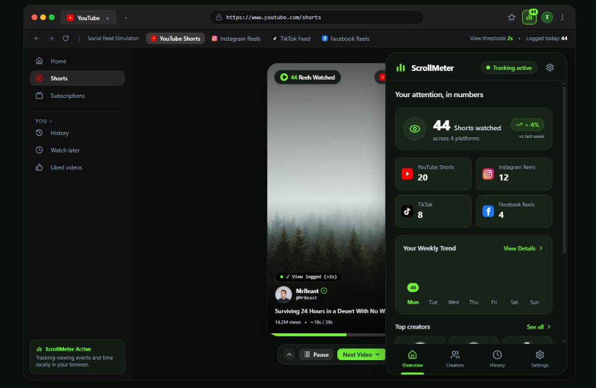

# 📱 ScrollMeter

> **Privacy-conscious short-form video tracking, analytics dashboard, and browser extension generator for YouTube Shorts, Instagram Reels, TikTok, and Facebook Reels.**

[](https://github.com/Tawhide16/scrollmeter/actions/workflows/ci.yml)
[](https://github.com/Tawhide16/scrollmeter/actions/workflows/docker-ci.yml)
[](https://react.dev/)
[](https://www.typescriptlang.org/)
[](https://vite.dev/)
[](https://tailwindcss.com/)
[](https://www.docker.com/)
[](LICENSE)

---

<div align="center">
  
</div>

<br />

## 🌟 Overview

**ScrollMeter** is an all-in-one productivity and digital wellbeing solution designed to give users control and clear visibility over their short-form video consumption habits.

Modern social feeds are engineered for friction-free endless scrolling. ScrollMeter operates completely **locally and privately**, recording time spent, video counts, and creator breakdowns across YouTube Shorts, Instagram Reels, TikTok, and Facebook Reels—without sending personal browsing data to any cloud service.

---

## ✨ Key Features

- 🔒 **100% Local-First & Privacy Preserving**:
  - All viewing logs are stored directly on your device via **IndexedDB** or `chrome.storage.local`.
  - Zero telemetry or remote analytics by default.
  - Optional **AES-256-GCM** client-side encryption powered by the Web Crypto API.
- 📊 **Rich Analytics & Insights**:
  - Daily & weekly watch count, total duration, and trends versus previous weeks.
  - Granular platform breakdown (YouTube Shorts, Instagram Reels, TikTok, Facebook Reels).
  - Top creators leaderboard sorted by total watch time and video count.
  - Searchable, filterable viewing history timeline.
- 🧩 **Built-in Manifest V3 Extension Packager**:
  - Inspect Chrome Extension Manifest V3 source code directly in the app.
  - One-click `.zip` export generated in-browser via JSZip, ready to load into any Chromium browser (`chrome://extensions`).
- 🎮 **Interactive Feed Simulator**:
  - Built-in simulation tool to test and experience the tracking engine, threshold triggers, and in-page overlays without visiting third-party sites.
- ⚙️ **Customizable Guardrails**:
  - Adjustable watch threshold (e.g. minimum 2 seconds before counting a view).
  - In-page floating counter position and visibility toggle.
  - Automated data retention policy (7, 30, 90 days, or permanent).
  - Full JSON, CSV, and formatted Markdown report export.
- 🏆 **Mindful Streaks & Wellbeing Milestones**:
  - Daily progress tracking against configurable mindful thresholds.
  - Interactive achievement badges (First Step, Mindful Starter, Habit Builder, Zen Master).
- 🐳 **Docker & Container Ready**:
  - Production-ready multi-stage Docker build served with high-performance Nginx and Gzip compression.

---

## 🏗️ Architecture & Tech Stack

```mermaid
flowchart TD
    subgraph Browser Extension ["Browser Extension (Manifest V3)"]
        CS[Content Scripts] -->|DOM Mutation & Video Observer| EN[Event Normaliser]
        EN -->|Viewing Events| SW[Service Worker / Background]
        SW -->|Local Storage API| CS_STORE[(Chrome Storage / IndexedDB)]
    end

    subgraph Web Dashboard ["Web Dashboard & Simulation"]
        VITE[Vite 8 + React 19] --> UI[Dashboard / Analytics]
        UI --> SIM[Feed Simulator]
        UI --> PKG[Extension ZIP Packager]
        UI --> IDB[(IndexedDB Storage)]
        UI --> CRYPTO[Web Crypto AES-GCM]
    end

    Browser Extension -.->|Import / Export| Web Dashboard
```

| Layer | Technology |
|---|---|
| **Framework** | [React 19](https://react.dev/) |
| **Language** | [TypeScript](https://www.typescriptlang.org/) |
| **Styling** | [Tailwind CSS v4](https://tailwindcss.com/) |
| **Bundler & Dev Server** | [Vite 8](https://vite.dev/) |
| **Motion & Animations** | [Motion](https://motion.dev/) & [Canvas Confetti](https://github.com/catdad/canvas-confetti) |
| **Icons** | [Lucide React](https://lucide.dev/) |
| **Extension Packing** | [JSZip](https://stuk.github.io/jszip/) |
| **Containerization** | Docker & Nginx Alpine |
| **CI/CD** | GitHub Actions |

---

## 🚀 Quick Start (Local Development)

### Prerequisites

- **Node.js**: v20 or higher (v22+ recommended)
- **npm**: v10 or higher

### Installation

1. **Clone the repository**:
   ```bash
   git clone https://github.com/Tawhide16/scrollmeter.git
   cd scrollmeter
   ```

2. **Install dependencies**:
   ```bash
   npm install --legacy-peer-deps
   ```

3. **Run automated unit tests**:
   ```bash
   npm test
   ```

4. **Verify types & code style**:
   ```bash
   npm run lint
   ```

5. **Start the development server**:
   ```bash
   npm run dev
   ```

6. **Open in browser**:
   Navigate to [http://localhost:3000](http://localhost:3000).

---

## 🐳 Docker Deployment

ScrollMeter includes a production-ready, multi-stage Docker setup with an optimized Nginx web server.

### Option A: Using Docker Compose (Recommended)

```bash
# Build and run container in background
docker compose up -d --build

# View container status
docker compose ps

# Access the app at http://localhost:3000
```

To stop:
```bash
docker compose down
```

### Option B: Using Docker CLI

```bash
# Build the image
npm run docker:build
# Or: docker build -t scrollmeter .

# Run the container
npm run docker:run
# Or: docker run -d -p 3000:80 --name scrollmeter-app scrollmeter
```

Open [http://localhost:3000](http://localhost:3000) in your browser.

---

## 📦 How to Install the Chrome Extension

1. Open ScrollMeter at [http://localhost:3000](http://localhost:3000).
2. Click **"Download Extension (.zip)"** in the top navigation or open the **Extension Packager** modal.
3. Extract the downloaded `scrollmeter-extension.zip` folder on your computer.
4. Open Google Chrome (or any Chromium browser like Brave, Edge, or Arc).
5. Navigate to `chrome://extensions/` in the address bar.
6. Enable **Developer mode** toggle in the top-right corner.
7. Click **Load unpacked** and select the extracted folder.
8. The ScrollMeter extension icon will appear in your browser toolbar!

---

## 🛠️ Available Scripts

| Command | Description |
|---|---|
| `npm run dev` | Starts the Vite development server on `http://localhost:3000` |
| `npm run build` | Builds optimized production distribution in `dist/` |
| `npm run preview` | Locally preview the production build |
| `npm run lint` | Runs TypeScript type checking without emitting files |
| `npm run clean` | Cleans up the `dist/` directory |
| `npm run docker:build` | Builds the production Docker image |
| `npm run docker:run` | Runs the Docker container on port 3000 |

---

## 📁 Project Structure

```text
scrollmeter/
├── .github/
│   └── workflows/
│       ├── ci.yml              # CI pipeline (lint + build checks)
│       └── docker-ci.yml       # Docker build verification
├── public/                     # Static public assets
├── src/
│   ├── components/
│   │   ├── CreatorsView.tsx    # Creator leaderboard & analytics
│   │   ├── ExtensionPackagerModal.tsx # Extension source inspector & builder
│   │   ├── ExtensionPopup.tsx  # Browser extension popup UI preview
│   │   ├── FeedSimulator.tsx   # Interactive short-form feed testing simulator
│   │   ├── HistoryView.tsx     # Filterable viewing event log
│   │   ├── LaunchGuideModal.tsx# Onboarding & installation modal
│   │   ├── NotificationToast.tsx # Real-time alerts & toasts
│   │   ├── PlatformIcons.tsx   # Brand logos & icons
│   │   ├── PlatformTabs.tsx    # Platform switching tabs
│   │   └── SettingsView.tsx    # Privacy, encryption & retention settings
│   ├── types/
│   │   └── scrollmeter.ts      # TypeScript interfaces and domain models
│   ├── utils/
│   │   ├── analytics.ts        # Data aggregation & summary calculations
│   │   ├── crypto.ts           # AES-GCM Web Crypto encryption helpers
│   │   ├── event-normaliser.ts # Normalizes platform-specific video events
│   │   ├── extension-generator.ts # Generates Chrome Extension source files & zip
│   │   ├── indexed-db.ts       # Local IndexedDB database manager
│   │   ├── mock-data.ts        # Seed data generator for testing
│   │   └── storage.ts          # Storage abstraction layer
│   ├── App.tsx                 # Main application root
│   ├── index.css               # Tailwind CSS styles
│   └── main.tsx                # React DOM entrypoint
├── .dockerignore               # Docker ignore rules
├── .editorconfig               # Code style formatting standards
├── .prettierrc                 # Prettier code formatting configuration
├── docker-compose.yml          # Docker Compose definition
├── Dockerfile                  # Multi-stage Docker container build
├── nginx.conf                  # Production Nginx reverse proxy configuration
├── package.json                # Project dependencies and npm scripts
├── tsconfig.json               # TypeScript compiler options
└── vite.config.ts              # Vite configuration
```

---

## 🔒 Privacy & Security Commitment

ScrollMeter adheres to strict local-first privacy principles:
- **Zero Third-Party Trackers**: No Google Analytics, Mixpanel, or third-party cookies.
- **Client-Side Encryption**: Optional password-based key derivation (PBKDF2) and AES-GCM encryption before storing viewing events.
- **Data Portability**: Users can export their full dataset to JSON/CSV or wipe all local storage with a single click.

---

## 🤝 Contributing

Contributions, feature suggestions, and bug reports are welcome!
Please check out [CONTRIBUTING.md](CONTRIBUTING.md) for details on getting started and submitting pull requests.

---

## 📄 License

This project is licensed under the [MIT License](LICENSE).

